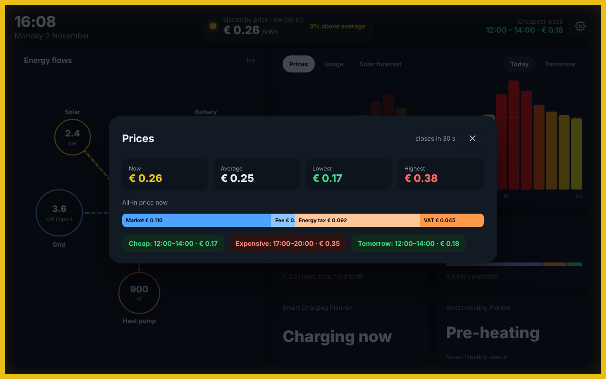
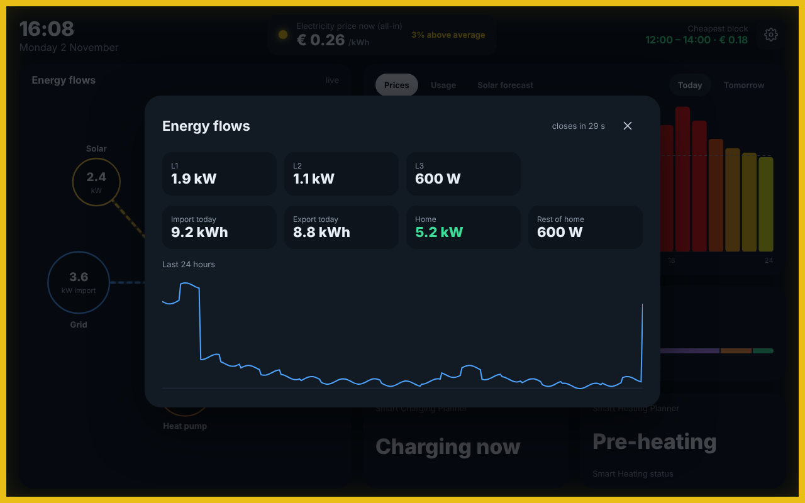
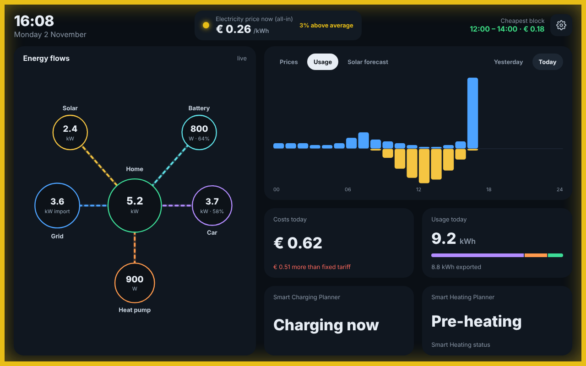
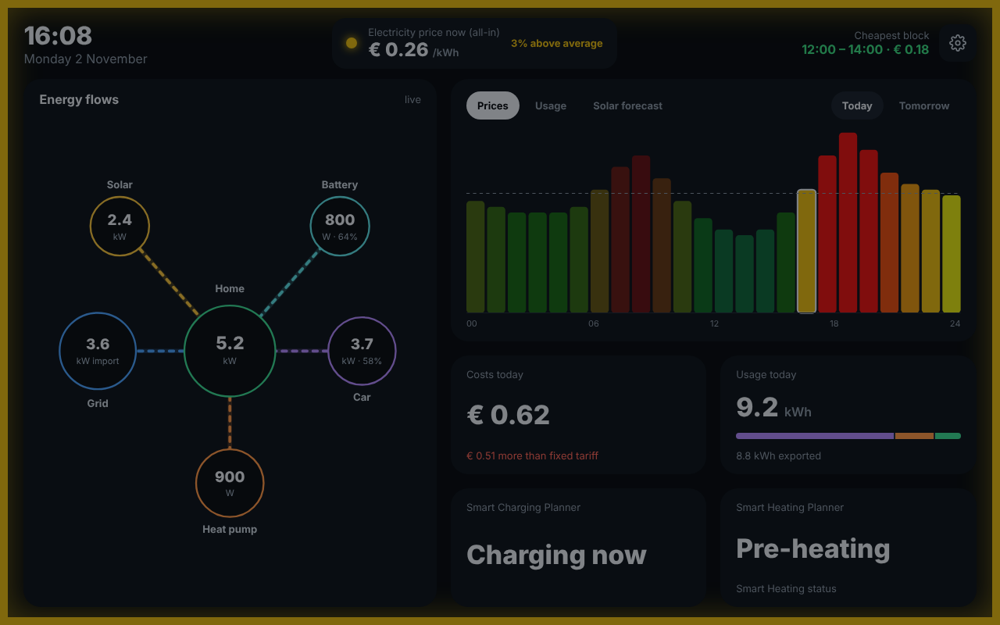
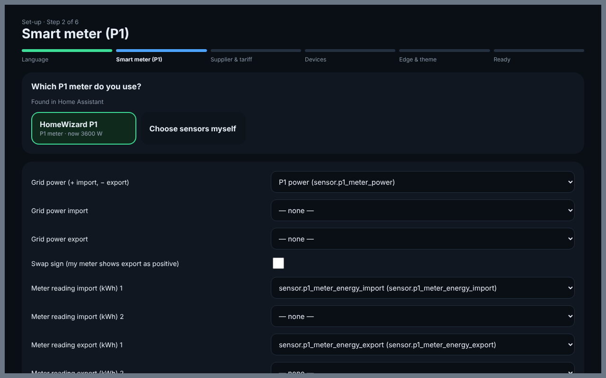
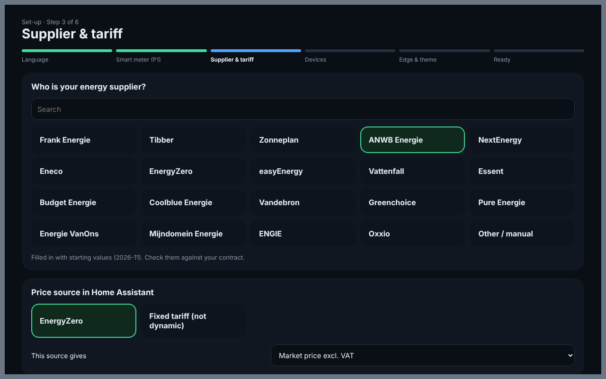
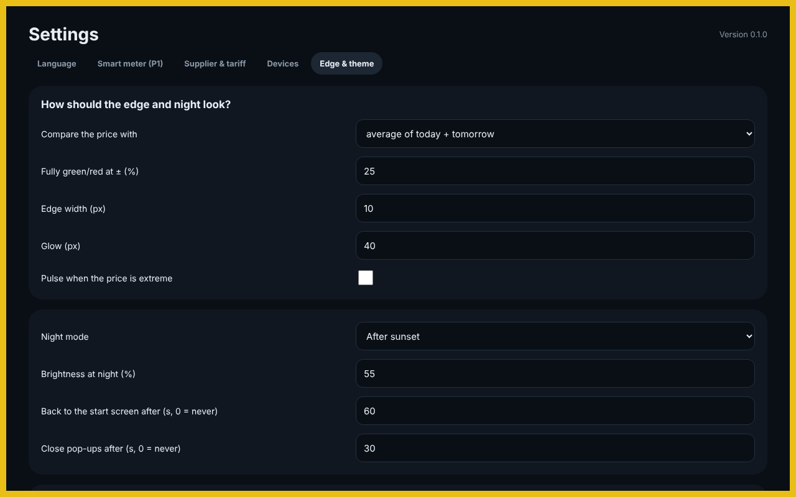

# Energy Dashboard

An interactive energy dashboard for Home Assistant, made for a wall tablet (kiosk).

> **Test version.** In Home Assistant add the repository `https://github.com/tlpeter/energy-dashboard#dev`; see [DOCS.md](energy_dashboard/DOCS.md). All screenshots use made-up demo data.

- **Live energy flows**: grid (P1 meter), home, car, heat pump, solar and battery. Each device is a module you add yourself.
- **Price edge**: the electricity price of today and tomorrow, all-in, with a coloured edge around the screen. Green is cheap, red is expensive, compared with the average.
- **Costs and usage**: costs, savings, usage per hour and the solar forecast.
- **Planners**: the plans of Smart Charging Planner and Smart Heating Planner.
- **Pop-ups**: tap anything for details. Pop-ups close by themselves and the screen returns to the start.
- **Read-only**: the app never changes anything in Home Assistant.

## Pop-ups

| Price now | Energy flows |
| --- | --- |
|  |  |

The **price pop-up** shows how the all-in price is built up, and the cheap and expensive blocks of today and tomorrow. The **energy flows pop-up** shows the phases, import and export today, and the last 24 hours.

## Chart

| Usage per hour (import up, export down) | Night mode |
| --- | --- |
|  |  |

The chart switches between **Prices**, **Usage** and **Solar forecast**. At night the screen dims, after sunset or between set times.

## Set-up wizard

The wizard starts at the first start. You can change everything later with the gear at the top right.

- **Language**: English or Nederlands.
- **P1 meter**: found automatically. Supported: HomeWizard, DSMR, DSMR Reader, SlimmeLezer/ESPHome, P1 Monitor and Tibber Pulse. You can also choose the sensors yourself.
- **Supplier**: Dutch suppliers, with starting values for the purchase fee.
- **Price source**: an integration in Home Assistant, or a fixed tariff.
- **Devices**, **edge**, **night mode** and **tiles**.

| Smart meter | Supplier & tariff |
| --- | --- |
|  |  |

## Licence

MIT.
